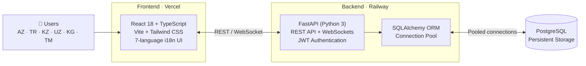
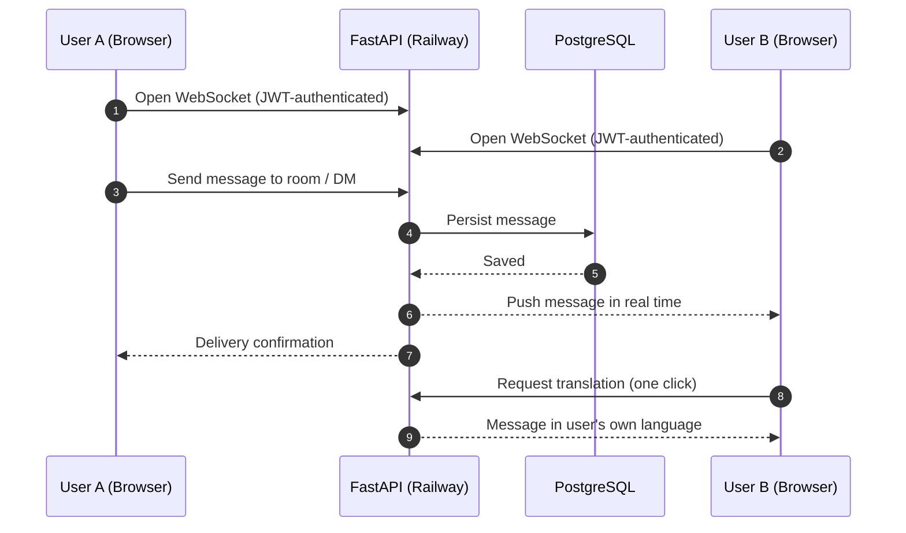
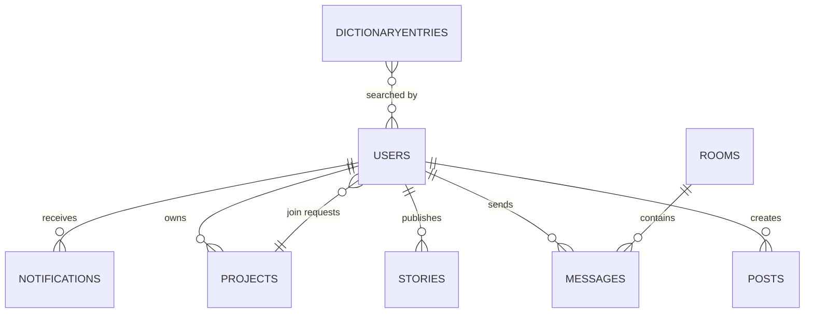

# 🌍 TURK HUB

### The Pan-Turkic Youth & Innovation Network

**One network. Six nations. Seven languages. Zero borders.**

[**🚀 Live Demo**](https://turk-hub.vercel.app) · [**🧩 Problem**](#problem-solution) · [**✨ Features**](#features) · [**🏗️ Architecture**](#architecture) · [**🗺️ Roadmap**](#roadmap) · [**🌐 Languages**](#multilingual) · [**📄 License**](#license)

**🌐 Read in:**
[🇦🇿 Azərbaycan](#azerbaijani) · [🇹🇷 Türkçe](#turkish) · [🇰🇿 Қазақша](#kazakh) · [🇺🇿 Oʻzbekcha](#uzbek) · [🇰🇬 Кыргызча](#kyrgyz) · [🇹🇲 Türkmençe](#turkmen)

---

## 📑 Table of Contents

1. [Executive Summary](#executive-summary)
2. [Problem & Solution](#problem-solution)
3. [Target Users](#target-users)
4. [Core Features](#features)
5. [Why TURK HUB Is Different](#differentiation)
6. [System Architecture](#architecture)
7. [Tech Stack](#tech-stack)
8. [Real-Time Messaging Flow](#realtime)
9. [API & Database Entities](#entities)
10. [Security & Reliability](#security)
11. [Demo Walkthrough](#demo)
12. [Future Roadmap](#roadmap)
13. [Investor FAQ](#faq)
14. [Multilingual Summaries](#multilingual)
15. [Contact](#contact)
16. [License & Copyright](#license)

---

## 🎯 Executive Summary

**TURK HUB** is a **Pan-Turkic Youth & Innovation Network** that connects **youth, students, startups, and verified organizations** across **Azerbaijan, Turkey, Kazakhstan, Uzbekistan, Kyrgyzstan, and Turkmenistan**.

The Turkic world shares deep historical, cultural, and linguistic roots, yet its young innovators work in separate digital silos. TURK HUB gives them one shared, multilingual, project-driven space where they can **communicate, understand each other, and build together**.

| | |
|---|---|
| **Product** | Full-stack, production-deployed web platform |
| **Live URL** | [https://turk-hub.vercel.app](https://turk-hub.vercel.app) |
| **Markets** | 🇦🇿 Azerbaijan · 🇹🇷 Turkey · 🇰🇿 Kazakhstan · 🇺🇿 Uzbekistan · 🇰🇬 Kyrgyzstan · 🇹🇲 Turkmenistan |
| **Interface languages** | Azerbaijani, Turkish, Kazakh, Uzbek, Kyrgyz, Turkmen, English |
| **Core idea** | Borderless communication + linguistic bridge + project-centric collaboration |
| **Founder & Creator** | Tahmina Aliyeva |

---

## 🧩 Problem & Solution

### The Problem

| # | Challenge | What it means in practice |
|---|-----------|---------------------------|
| 1 | **Digital fragmentation** | Turkic youth, students, and startups are scattered across unrelated global platforms. No shared digital home exists for the region. |
| 2 | **Linguistic & terminological barriers** | Turkic languages are closely related but not fully mutually intelligible. Vocabulary, spelling, and terminology differ, which slows down collaboration. |
| 3 | **No centralized collaboration hub** | There is no dedicated place to form cross-border teams, match skills, join hackathons, or launch research and startup projects together. |

### The Solution: Three Core Pillars

| Pillar | Description | Delivered by |
|--------|-------------|--------------|
| 🗣️ **Borderless Communication** | One network where users from six countries talk in real time, publicly and privately. | Live chat rooms, direct messages, social feed, stories, notifications |
| 🌉 **Linguistic Bridge** | Users stay in their own language while understanding everyone else. | 7-language UI, one-click cross-dialect translation, comparative etymology dictionary |
| 🤝 **Project-Centric Collaboration** | Connections turn into real output: teams, startups, research, hackathons. | Project Hub with team formation, skill matching, and join-request management |

---

## 👥 Target Users

| Segment | What they get from TURK HUB |
|---------|-----------------------------|
| 🎓 **Students & Youth** | A cross-border community, peer networking, and projects to join. |
| 🚀 **Startup Founders** | A place to find co-founders and teammates with the right skills in neighboring Turkic markets. |
| 🏆 **Hackathon Participants & Organizers** | Team formation, project visibility, and a channel to announce events. |
| 🏛️ **Verified Organizations & Forums** | Official announcements, a trusted presence, and direct reach to young talent. |
| 🔬 **Researchers & Linguists** | A comparative etymology dictionary and a community focused on Turkic language heritage. |

---

## ✨ Core Features

### 1. 🌐 7-Language Localized UI
The full interface is available in **Azerbaijani, Turkish, Kazakh, Uzbek, Kyrgyz, Turkmen, and English**. Users can switch language at any time, so each person works in their own language.

### 2. 🔁 Instant Cross-Dialect Translation
- One-click translation of **social feed posts**
- One-click translation of **direct messages**
- Works across Turkic languages, which removes the need to leave the platform or use third-party tools

### 3. 💬 Real-Time WebSocket Rooms & Direct Messaging
- **Country-based live chat rooms**, one for each nation
- A **global live chat room** for the entire network
- **Private direct messages** between users
- **Persistent message history** stored in PostgreSQL, so conversations survive reloads and reconnects

### 4. 📚 Pan-Turkic Etymology Dictionary (Sözlük)
- **Comparative root lookup** across **6 Turkic languages**
- **Historical etymology** that shows how shared roots evolved in each language
- A built-in educational and cultural tool that reinforces shared linguistic identity

### 5. 🚀 Project Hub
- **Team formation** for startups, research projects, and hackathons
- **Skill matching** between project needs and member abilities
- **Join-request management** so project owners can review and respond to applicants

### 6. 📰 Social Feed, 24h Stories & Verified Organizations

| Capability | Details |
|------------|---------|
| **Social feed** | Posts, likes, comments, and saved bookmarks |
| **24h Stories** | Ephemeral content that expires after 24 hours |
| **User profiles** | Isolated, individual profiles for every member |
| **Verified organizations** | Official organization and forum announcements |
| **Notifications** | Real-time alerts for interactions and activity |
| **Admin Panel** | Role-based moderation and platform management |

---

## 🏆 Why TURK HUB Is Different

| Capability | General social networks | Messaging apps | Translation tools | Hackathon / team platforms | **TURK HUB** |
|------------|:----:|:----:|:----:|:----:|:----:|
| Built specifically for the Turkic world | ❌ | ❌ | ❌ | ❌ | ✅ |
| Localized UI in all 6 Turkic languages | ❌ | ❌ | ⚠️ | ❌ | ✅ |
| In-context Turkic dialect translation | ⚠️ | ⚠️ | ✅ | ❌ | ✅ |
| Country-based and global live rooms | ⚠️ | ⚠️ | ❌ | ❌ | ✅ |
| Comparative Turkic etymology dictionary | ❌ | ❌ | ❌ | ❌ | ✅ |
| Team formation & skill matching | ❌ | ❌ | ❌ | ✅ | ✅ |
| Verified organizations & forums | ⚠️ | ❌ | ❌ | ⚠️ | ✅ |

> ✅ native · ⚠️ partial or general-purpose · ❌ not offered.
> **The moat:** TURK HUB combines community, language, and collaboration tools in one regionally focused product. Global platforms treat these as separate problems and do not optimize for the Turkic world.

---

## 🏗️ System Architecture

### Design Principles

| Principle | How it is applied |
|-----------|-------------------|
| **Decoupled deployment** | The frontend (Vercel) and backend (Railway) deploy and scale independently. |
| **Dual transport** | REST for standard operations; WebSockets for real-time chat and live updates. |
| **Stateless auth** | JWT-based authentication keeps API instances horizontally scalable. |
| **Persistent real-time** | Live messages are written to PostgreSQL, so history is never lost. |
| **Resilient data layer** | Tuned connection pooling prevents stale-connection failures on cloud infrastructure. |

---

## 🛠️ Tech Stack

| Layer | Technology | Hosting |
|-------|-----------|---------|
| **Frontend** | React 18 · TypeScript · Vite · Tailwind CSS | Vercel: [turk-hub.vercel.app](https://turk-hub.vercel.app) |
| **Backend** | FastAPI · Python 3 · SQLAlchemy · WebSockets · JWT Authentication | Railway |
| **Database** | PostgreSQL | Managed PostgreSQL |

### Why this stack?

| Choice | Reason |
|--------|--------|
| **React 18 + TypeScript** | Type-safe, component-driven UI that is maintainable as the product grows. |
| **Vite** | Fast builds and a modern developer experience. |
| **Tailwind CSS** | Consistent, responsive design delivered quickly. |
| **FastAPI** | High-performance async Python framework with native WebSocket support. |
| **SQLAlchemy** | Mature ORM with robust pooling and relational modeling. |
| **PostgreSQL** | Reliable relational database suited to social graphs, messages, and structured content. |

### Database Connection Pooling

| Parameter | Value | Purpose |
|-----------|-------|---------|
| `pool_pre_ping` | `True` | Tests each connection before use and prevents errors from stale connections. |
| `pool_recycle` | `280` | Recycles connections every 280 seconds, before cloud idle timeouts drop them. |
| `pool_size` | `5` | Persistent connections kept ready in the pool. |
| `max_overflow` | `10` | Extra connections allowed during traffic bursts. |

---

## ⚡ Real-Time Messaging Flow

---

## 🗄️ API & Database Entities

| Entity | Description | Transport |
|--------|-------------|-----------|
| **Users** | Accounts, profiles, roles (member, verified organization, admin), language preference, and JWT authentication | REST |
| **Posts** | Social feed content with likes, comments, bookmarks, and on-demand translation | REST |
| **Stories** | 24-hour ephemeral content that expires automatically | REST |
| **Messages** | Direct and room messages with persistent history | REST + WebSocket |
| **Rooms** | Country-based and global real-time chat rooms | WebSocket |
| **Projects** | Startup, research, and hackathon projects with required skills and join requests | REST |
| **DictionaryEntries** | Comparative roots and etymology across 6 Turkic languages | REST |
| **Notifications** | Real-time alerts for interactions, messages, and join requests | REST + WebSocket |

### Conceptual Entity Relationships

---

## 🔐 Security & Reliability

| Area | Approach |
|------|----------|
| **Authentication** | JWT-based, stateless authentication for REST and WebSocket access. |
| **Authorization** | Role-based access control, including a dedicated Admin Panel. |
| **Trust & verification** | Verified organizations carry official status for announcements and forums. |
| **Data persistence** | Messages and content are stored durably in PostgreSQL. |
| **Connection health** | Pre-ping and recycling prevent dropped or stale database connections. |
| **Isolation** | Each user profile is isolated, and private direct messages stay between participants. |
| **Deployment** | Managed cloud hosting on Vercel and Railway with independent frontend and backend lifecycles. |

---

## 🎬 Demo Walkthrough

Experience the platform in about two minutes at **[turk-hub.vercel.app](https://turk-hub.vercel.app)**:

| Step | Action | What it shows |
|------|--------|---------------|
| 1 | Switch the interface language | The 7-language localized UI |
| 2 | Open the social feed and translate a post | Cross-dialect translation |
| 3 | Join a country or global chat room | Real-time WebSocket communication |
| 4 | Send a direct message | Private chat with persistent history |
| 5 | Search a word in **Sözlük** | Comparative etymology across 6 languages |
| 6 | Browse the **Project Hub** | Team formation and skill matching |
| 7 | Explore Stories, organizations, and notifications | The full social and trust layer |

---

## 🗺️ Future Roadmap

| Phase | Initiative | Description |
|-------|-----------|-------------|
| 🤖 **Next** | **AI Turkic NLP Translation Models** | Dedicated machine-translation models trained on Turkic dialect pairs, for higher accuracy, better terminology, and cultural nuance. |
| 📱 **Planned** | **Native Mobile Apps** | iOS and Android apps with push notifications and a fast, mobile-first chat experience. |
| 🎓 **Planned** | **University & Hackathon Verification APIs** | Automated verification of students, universities, and hackathon organizers, to strengthen trust and credibility across the network. |

---

## ❓ Investor FAQ

<b>What problem does TURK HUB solve?</b>

 

It removes the digital, linguistic, and collaboration barriers that keep Turkic-speaking youth and startups apart. It does this with one multilingual network built around real projects.

<b>Is the product live?</b>

 

Yes. The platform is deployed and publicly accessible at [turk-hub.vercel.app](https://turk-hub.vercel.app).

<b>Which countries and languages are supported?</b>

 

Azerbaijan, Turkey, Kazakhstan, Uzbekistan, Kyrgyzstan, and Turkmenistan. The interface is available in Azerbaijani, Turkish, Kazakh, Uzbek, Kyrgyz, Turkmen, and English.

<b>Is the architecture production-ready and scalable?</b>

 

The frontend and backend are decoupled and independently hosted (Vercel and Railway). The API uses stateless JWT authentication, and the database layer uses tuned connection pooling. These choices let each tier scale separately.

<b>What makes the product defensible?</b>

 

It combines community, translation, a comparative etymology dictionary, and project collaboration in one product built for a specific region. Its data, such as dialect-specific content and Turkic terminology, becomes more valuable as the network grows.

<b>Where is the product going next?</b>

 

The roadmap covers AI Turkic NLP translation models, native mobile apps, and university and hackathon verification APIs. See the [Future Roadmap](#roadmap).

---

## 🌐 Multilingual Summaries

TURK HUB is built for the Turkic world, so here is a short summary of the platform in each of the six Turkic languages it supports.

<b>🇦🇿 Azərbaycan</b>

### TURK HUB nədir?

**TURK HUB** Azərbaycan, Türkiyə, Qazaxıstan, Özbəkistan, Qırğızıstan və Türkmənistan gənclərini, tələbələrini, startaplarını və təsdiqlənmiş təşkilatlarını bir araya gətirən **Pan-Türk Gənclər və İnnovasiya Şəbəkəsidir**.

**Əsas imkanlar:**
- 🌐 7 dildə tam lokallaşdırılmış interfeys
- 🔁 Türk dilləri arasında bir kliklə tərcümə
- 💬 Real vaxt rejimində ölkə və qlobal söhbət otaqları, şəxsi mesajlar
- 📚 6 türk dilində müqayisəli etimologiya lüğəti (Sözlük)
- 🚀 Komanda yığımı, bacarıq uyğunlaşdırması və qoşulma sorğuları üçün Layihə Mərkəzi
- 📰 Sosial lent, 24 saatlıq hekayələr, təsdiqlənmiş təşkilatlar, bildirişlər və Admin Paneli

🔗 [turk-hub.vercel.app](https://turk-hub.vercel.app)

[⬆️ Yuxarı qayıt](#top)

<b>🇹🇷 Türkçe</b>

### TURK HUB Nedir?

**TURK HUB**, Azerbaycan, Türkiye, Kazakistan, Özbekistan, Kırgızistan ve Türkmenistan'daki gençleri, öğrencileri, girişimleri ve doğrulanmış kuruluşları buluşturan **Pan-Türk Gençlik ve İnovasyon Ağı**'dır.

**Temel özellikler:**
- 🌐 7 dilde tam yerelleştirilmiş arayüz
- 🔁 Türk lehçeleri arasında tek tıkla çeviri
- 💬 Gerçek zamanlı ülke ve global sohbet odaları, özel mesajlaşma
- 📚 6 Türk dilinde karşılaştırmalı etimoloji sözlüğü (Sözlük)
- 🚀 Takım kurma, beceri eşleştirme ve katılım talepleri için Proje Merkezi
- 📰 Sosyal akış, 24 saatlik hikâyeler, doğrulanmış kuruluşlar, bildirimler ve Yönetici Paneli

🔗 [turk-hub.vercel.app](https://turk-hub.vercel.app)

[⬆️ Başa dön](#top)

<b>🇰🇿 Қазақша</b>

### TURK HUB дегеніміз не?

**TURK HUB** — Әзірбайжан, Түркия, Қазақстан, Өзбекстан, Қырғызстан және Түрікменстанның жастарын, студенттерін, стартаптарын және расталған ұйымдарын біріктіретін **Пантүркілік жастар мен инновациялар желісі**.

**Негізгі мүмкіндіктер:**
- 🌐 7 тілдегі толық локализацияланған интерфейс
- 🔁 Түркі тілдері арасында бір рет басып аудару
- 💬 Нақты уақыттағы елдік және жаһандық чат бөлмелері, жеке хабарламалар
- 📚 6 түркі тіліндегі салыстырмалы этимологиялық сөздік (Sözlük)
- 🚀 Команда құру, дағдыларды сәйкестендіру және қосылу сұрауларына арналған Жобалар орталығы
- 📰 Әлеуметтік лента, 24 сағаттық тарихтар, расталған ұйымдар, хабарландырулар және Әкімші панелі

🔗 [turk-hub.vercel.app](https://turk-hub.vercel.app)

[⬆️ Жоғарыға оралу](#top)

<b>🇺🇿 Oʻzbekcha</b>

### TURK HUB nima?

**TURK HUB** — Ozarbayjon, Turkiya, Qozogʻiston, Oʻzbekiston, Qirgʻiziston va Turkmanistonning yoshlari, talabalari, startaplari va tasdiqlangan tashkilotlarini birlashtiruvchi **Pan-turkiy yoshlar va innovatsiyalar tarmogʻi**dir.

**Asosiy imkoniyatlar:**
- 🌐 7 tilda toʻliq lokalizatsiya qilingan interfeys
- 🔁 Turkiy tillar oʻrtasida bir bosishda tarjima
- 💬 Real vaqtdagi mamlakat va global chat xonalari, shaxsiy xabarlar
- 📚 6 turkiy tilda qiyosiy etimologiya lugʻati (Sözlük)
- 🚀 Jamoa tuzish, koʻnikmalarni moslashtirish va qoʻshilish soʻrovlari uchun Loyihalar markazi
- 📰 Ijtimoiy lenta, 24 soatlik hikoyalar, tasdiqlangan tashkilotlar, bildirishnomalar va Admin paneli

🔗 [turk-hub.vercel.app](https://turk-hub.vercel.app)

[⬆️ Yuqoriga qaytish](#top)

<b>🇰🇬 Кыргызча</b>

### TURK HUB деген эмне?

**TURK HUB** — Азербайжан, Түркия, Казакстан, Өзбекстан, Кыргызстан жана Түркмөнстандын жаштарын, студенттерин, стартаптарын жана ырасталган уюмдарын бириктирген **Пантүрк жаштар жана инновация тармагы**.

**Негизги мүмкүнчүлүктөр:**
- 🌐 7 тилдеги толук локалдаштырылган интерфейс
- 🔁 Түрк тилдеринин ортосунда бир басуу менен котормо
- 💬 Реалдуу убакыттагы өлкөлүк жана глобалдык чат бөлмөлөрү, жеке билдирүүлөр
- 📚 6 түрк тилиндеги салыштырма этимологиялык сөздүк (Sözlük)
- 🚀 Команда түзүү, көндүмдөрдү дал келтирүү жана кошулуу өтүнүчтөрү үчүн Долбоорлор борбору
- 📰 Социалдык лента, 24 сааттык окуялар, ырасталган уюмдар, эскертмелер жана Админ панели

🔗 [turk-hub.vercel.app](https://turk-hub.vercel.app)

[⬆️ Жогору кайтуу](#top)

<b>🇹🇲 Türkmençe</b>

### TURK HUB näme?

**TURK HUB** — Azerbaýjanyň, Türkiýäniň, Gazagystanyň, Özbegistanyň, Gyrgyzystanyň we Türkmenistanyň ýaşlaryny, talyplaryny, startaplaryny we tassyklanan guramalaryny birleşdirýän **Pan-türki ýaşlar we innowasiýa ulgamydyr**.

**Esasy mümkinçilikler:**
- 🌐 7 dilde doly lokallaşdyrylan interfeýs
- 🔁 Türki dilleriň arasynda bir basyşda terjime
- 💬 Hakyky wagtdaky ýurt we global çat otaglary, şahsy habarlar
- 📚 6 türki dilde deňeşdirme etimologiýa sözlügi (Sözlük)
- 🚀 Topar döretmek, başarnyklary deňeşdirmek we goşulmak haýyşlary üçin Taslamalar merkezi
- 📰 Sosial lenta, 24 sagatlyk hekaýalar, tassyklanan guramalar, bildirişler we Admin paneli

🔗 [turk-hub.vercel.app](https://turk-hub.vercel.app)

[⬆️ Ýokary gaýtmak](#top)

---

## 📬 Contact

| | |
|---|---|
| **Founder** | Tahmina Aliyeva |
| **Live platform** | [https://turk-hub.vercel.app](https://turk-hub.vercel.app) |
| **Repository** | [github.com/Alijewa25/turk-hub](https://github.com/Alijewa25/turk-hub) |

For partnership, investment, pilot program, or licensing inquiries, please reach out through the GitHub repository.

---

## 📄 License & Copyright

**TURK HUB is proprietary software.** The source code, design, branding, content, database schemas, translations, and all related materials are the exclusive intellectual property of the author.

Unless you have prior written permission from the copyright holder, you may **not** copy, modify, distribute, sublicense, reverse-engineer, host, or create derivative works from any part of this software. Use of the live platform at [turk-hub.vercel.app](https://turk-hub.vercel.app) is subject to its terms of use.

**© 2026 Tahmina Aliyeva — TURK HUB. All Rights Reserved.**

*Built with ❤️ for the Turkic world.*

[⬆️ Back to top](#top)

